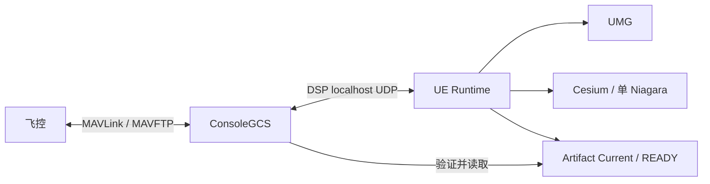

# 当前架构：以源码为准

Status: AUDITED CURRENT；基线：`a95309d8b37ecb00c779d5c4264aacb86294d8ec`；2026-09-09。
本轮只做静态审计，未编译、未重跑回归、未连接真机。相对源码链接从本目录出发。未来方案见 [04](04_TARGET_ARCHITECTURE.md)，不要将方案当作已实现功能。

## 1. 实际运行边界

Console 是一个 C++17/v143 EXE，拥有真实网络和飞控状态；UE 是一个 `DroneShowPlatform1` Runtime 模块，包含 UI、应用工作流、航线领域、DSP 适配和渲染。Shared 是被两端编译包含的 header-only 合同与算法，不是独立运行服务。Launcher 复用 Console 配置解析源码，但不链接飞控运行实例。

## 2. Command 正向与返回链

`WBP 控件 → UGCSUIBridgeSubsystem Handler → SubmitSelectedProductionCommand → UDSPGCSProductionCommandProviderSubsystem::SubmitCommand → ToProtocolType / EncodeCommand → ProductionTelemetryProvider::SendFrame → FDSPGCSLoopbackTransport → ConsoleDSPGCSLoopbackTransport → Application 分流 → DSPGCSProductionCommandReceiver::EnqueueFrame → 主循环 ProcessPending → CommandManager::Submit → DroneManager::FindDrone → DroneSession::SubmitCommand → CommandDispatcher::Queue* → Tick / Send → MavlinkCommand → UdpClient → MavlinkUdpReceiver::SendTo → 原 Remote Endpoint`。

返回：`入站 Endpoint → Session 校验 → CommandDispatcher::HandleAck/HandleHeartbeat/HandleTelemetryMessage → ConsumeResults → Session 完成队列 → CommandManager::Tick → DSP Receiver::ToResultBatch → EncodeCommandResult → UE Provider::HandleResultPayload → GameThread ApplyResultBatch → OnCommandResult → UIBridge`。

三个 ID 不可混同：UE 字符串 CommandID、Console batch uint64 ID、每 Session dispatcher request ID；MAV_CMD 是协议动作编号，不是上述请求 ID。`dispatchOwners` 使用 DroneID + request ID 关联。

### 命令合同矩阵

源： [DroneCommandRequest.h](../../ConsoleGCS/DroneCommandRequest.h)、[CommandDispatcher.cpp](../../ConsoleGCS/CommandDispatcher.cpp)、[MavlinkCommand.cpp](../../ConsoleGCS/MavlinkCommand.cpp)。MAVLink 常量只列符号，精确参数仍以 encoder 和捕获报文测试为准。

| 命令 | 当前执行方式 | 完成语义/特别约束 |
|---|---|---|
| Arm / Disarm | COMPONENT_ARM_DISARM；普通上锁 param1=0,param2=0 | ACK；不证明停桨，不能恢复旧 GPS 着陆门禁 |
| Takeoff / Land | NAV_TAKEOFF / NAV_LAND | ACK；起飞高度受现有 gate |
| RTL | Dispatcher 使用 SetMode 的 RTL 模式确认路径 | HEARTBEAT 模式确认；不可因存在 `MavlinkCommand::RTL` 就换调用 |
| SetMode | SET_MODE | QueueSetMode等待HEARTBEAT custom_mode确认；不同于无ACK灯光/授时 |
| HoverTest | FlightControl 启动线程，GUIDED → ARM → TAKEOFF，观察遥测 | 顶层立即 Accepted 表示工作流受理；不等于悬停完成；不会自动 LAND/RTL |
| SetLedColor | 自定义 LED_CONTROL #186 | 无标准 COMMAND_ACK 的发送结果，不是灯光物理确认 |
| TimeStart / TimeStop | 自定义 MP_TIME_CONTROL #78 | 发送语义；NPZ 不自动播放 |
| ExecuteDanceStep / EndDanceStep | AUTO + USER_1(1) / 取消授时 + USER_1(0) | 复合发包，不能拆成新的独立用户命令 |
| MissionPause | LegacyMissionPause / NAV_LOITER_UNLIM，param1=1 | UI 按结果记录暂停目标 |
| MissionForward / Backward | LegacyMissionPlayback / NAV_RETURN_TO_LAUNCH，param1=0/1 | 仅已暂停目标；成功后清除暂停资格；不等于普通 RTL |
| ChangeSpeed | USER_2 | 既有 1～5 m/s gate |
| TriggerSmoke | DO_SET_RELAY，relay 0 ON 后 1 秒 OFF | ON ACK 丢失仍计划 OFF；保持当前重试、优先级与时序 |
| StopTelemetry / ResumeTelemetry | SET_MESSAGE_INTERVAL：1/24/33/30/187 | -1 / 1000000μs；恢复最终等待新 #187 |
| DisableLedOutput / RestoreLedOutput | USER_3 | 参数由既有 bool 编码 |
| Wake / Standby / Reboot | PREFLIGHT_REBOOT_SHUTDOWN，autopilot_action=4/2/1 | 动作参数不可重解释；待机/重启 armed gate |
| Shutdown | DO_SET_RELAY，relay 1 latch=1 | armed gate + UE 二次点击；ACCEPTED 不证明断电 |
| Route Upload | 独立 Upload Job | 不经过短命令 Dispatcher |

## 3. Telemetry 全链与字段覆盖

Console 主循环 `receiver.Receive → MavlinkReadOnlyIngress::SubmitDatagram` 按 Endpoint 保存 parser buffer，使用 MAVLink framing 解码；HEARTBEAT 进入 Discovery，其他报文只路由已知 Session。`MavlinkParser::ParseAt → workingData → DataManager::Update` 发布一致副本。

`DSPGCSProductionTelemetryProvider::ToTelemetryDTO → PublishSnapshot 分片 → UDP → UE HandleTransportFrame/DecodeTelemetry/TryAssembleTelemetrySnapshot → ToProductionFleetDrone → GCSServerAdapter::PushFleetSnapshot → 合并队列 → GameThread FlushPendingData → FleetManager::ApplySnapshot → UI / Visualization`。

另有两条明确分支：完整 #187 表格投影保存在 UE Provider 的加锁 `MDHKTelemetryRows`；GPS 原始样本观测通过 GameThread task 交给 `RouteGpsCaptureSubsystem`。它们不是从 Widget 反推的数据源。

| 字段 | Console 来源 | 当前 UE 标准 Fleet 覆盖 |
|---|---|---|
| 纬度/经度/AMSL/Fix/卫星 | #24 GPS_RAW_INT，1e-7度、毫米换算 | 经纬高/Fix/时间戳投影；卫星列表读取 #187 表格补充 |
| 相对高度 | #33 GLOBAL_POSITION_INT，毫米→米 | `Altitude`；不得与 `AltitudeAMSL` 合并 |
| 速度 | #33 vx/vy→水平 groundSpeed | 当前标准 DSP TelemetryDTO 没有完整速度投影，不能称全链已覆盖 |
| 姿态 | #30 roll/pitch/yaw | Console 保存；当前标准 Fleet 未完整投影 |
| 电池 | #1 + #187 扩展字段 | 标准百分比 + 独立详细表；invalid 百分比在标准投影使用 0，保留现状 |
| FlightMode / Armed | HEARTBEAT | DSP 含 mode.armed；`ToProductionFleetDrone` 未传入 armed 字段，模式名有投影 |
| 心跳/在线 | Session lastHeartbeat、timeout | DSP connection；UE 另有 Console link health，不能把 LinkLost 写成每机 Offline |
| RGB | #187 | 映射 DSP led → Fleet LEDColor/valid → Visualization |

上述覆盖缺口是当前能力边界，不是本轮允许修复的功能。

## 4. 状态归属与副本

| 状态 | Owner | 合法副本/派生 | 不允许的解释 |
|---|---|---|---|
| Remote Endpoint、DroneID、发现顺序 | Console DroneManager / Session | DSP linkId、UE EndpointIdentity | SYSID 是全局唯一身份 |
| 最新飞控状态 | Session workingData，DataManager 发布快照 | DSP DTO、UE Fleet | 多副本就必然是多 Authority |
| 单机详情选择 | Fleet CurrentSelectedDroneID | 行高亮/详情展示 | 自动成为命令目标 |
| 命令选择 | UIBridge SelectedCommandDroneIDs | checkbox、Niagara mask | 筛选结果自动选择 |
| 暂停资格、命令聚合、确认窗口 | UIBridge | UI 文本 | 飞控真实任务状态；这是 UI 解耦的主要迁移对象 |
| Route ENU / Origin / rate / Playback | RoutePreviewSubsystem | Niagara preview | 真实遥测 |
| 稳定 GPS capture | RouteGpsCaptureSubsystem | 捕获结果、候选匹配 | 最新单点 GPS 等于稳定窗口 |
| Confirmed NPZ Mapping | GCSRouteWorkflowCoordinator | 上传快照、显示覆盖 | 当前勾选必然覆盖确认映射 |
| Working / Frozen Assignment | RouteAssignmentSubsystem | Console Accepted store | 新建第二套 Assignment |
| Upload 执行 | ConsoleUploadJobAuthority + RouteUploadManager | UE StateMirror、ListItem | 行对象拥有任务状态 |
| Live 插值 | 单 Visualization Actor 的每机两样本 cache | Niagara arrays | 每机 Actor/Tick |

## 5. Upload 全链及交接差异

`选择/已确认 NPZ Mapping → Coordinator::CaptureAutoStartSnapshot → explicit Working Assignment → Freeze(AllowDegraded) → FrozenSync schema2 → Console Receiver/Assembler/Store Accepted → 重校验 identity → UDSPGCSUploadJobSubsystem → DSP Upload Job schema3（含 runtime config binding） → ConsoleUploadJobAuthority → ConsoleArtifactConsumerV2 校验 Current/READY/hash/read lease → RouteUploadManager → MissionPreparationWorker → MAVFTPMissionTransport → MissionFtpCompiler segment → Session MavFtpClient → shared sender`。

返回：FTP ACK/NAK 由 Endpoint-bound Client 校验 sequence/session/offset/opcode；逐段 Terminate ACK 后继续下一段；末段后 `MissionUploadTransaction` 验证 Count/Home/First/Last；Job 快照/分页/delta 回到 UE Mirror，再更新稳定行。

**当前源码默认映射是 NumericDroneID，不是 NumericDroneID - 1**：`Drone000→0`。有 Confirmed NPZ Mapping 时，校验其 dataset/revision 后使用 Entries 的目标集合与 Slot；当前 UI 选择不再单独决定这个上传集合。见 [共享编号](../../Shared/DroneIdentity/DroneLogicalId.h)、[实际工作流](../../UnrealGCS/Source/DroneShowPlatform1/Private/GCSRouteWorkflowCoordinator.inl) 中 `CaptureAutoStartSnapshot`。本轮记录差异，不恢复旧规则。

并发 1～50 与 Write cap 1～800 是两个维度；当前有 DSP runtime cap 查询/应用与 binding，并非只有启动 INI。segment_items=4000 含 Home；9100→9101→4000+4000+1101 是用户确认历史硬件证据。

## 6. 多机与生命周期

Console `unordered_map<DroneID, unique_ptr<DroneSession>> + Endpoint index + sessionOrder`；offline 不删除，进程重启稳定 ID 未保证。UE `FleetManager` 保存 DroneOrder，Visualization 保存 ParticleDroneIDs；RouteSlot 与显示编号不能成为网络身份。未发现生产全局 CurrentDrone 决定全部发包的结构。

主循环拥有 DroneManager、Session ingress、Job Tick。DSP 接收线程只加锁入队；准备线程处理不可变 Artifact；Console renderer 单独消费快照和日志。**HoverTest 的 FlightControl 每活动 Session 创建 hoverThread**，这是当前实现与旧“不使用 per-drone thread”描述的差异，不能在无行为变更治理中直接换调度器。

UE 用 GameInstanceSubsystem 承载长生命周期状态；Coordinator/Filter/行绑定是 UObject；主界面是 Blueprint UUserWidget，经反射名称接线；没有必要为了 UI 替换新建每机 ActorComponent。委托和 Ticker 大多有配对清理，但 weak pointer 不等于 Deinitialize 取消 token，详见 [08](08_BEHAVIOR_RISKS.md)。
