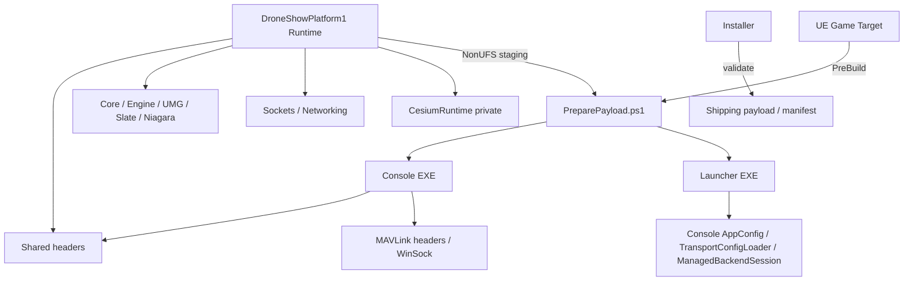

# 当前模块与主要类依赖图

Status: AUDITED CURRENT；基线 `a95309d8`；依赖箭头表示编译/调用，不表示网络方向。

## 1. 编译与部署依赖

Game Target预构建与NonUFS暂存形成构建顺序，不是C++循环链接。Editor Target不执行该payload预构建。Launcher并不链接整套Console，直接复用两个配置.cpp。Shared没有include Console/UE领域类，但Windows条件include包含UE Windows wrapper适配。

`DroneShowPlatform1.Build.cs` Public：Core/CoreUObject/Engine/InputCore/EnhancedInput/UMG/Slate/SlateCore/Sockets/Networking/Niagara；Private：CesiumRuntime/EngineSettings；zlib私有第三方；Win64 Ole32/Shell32/Uuid/Bcrypt系统库。Shared各目录与UE MAVLink路径当前为PublicIncludePaths。外部UnrealMCP是Editor模块，非Runtime依赖。

## 2. Console Class → Class

| 调用/持有者 | 依赖对象 | 关系与线程 |
|---|---|---|
| ConsoleGCSApplication | AppConfig、SafetyConfig、ManagedBackendSession、所有生产服务 | 主循环composition root；生命周期声明順序重要 |
| DroneManager | unique_ptr DroneSession、DiscoveredDroneIdentity | 唯一Session owner；主线程 |
| MavlinkReadOnlyIngress | DiscoveryService、DroneManager、Session | 每Endpoint parser状态，主循环路由 |
| DiscoveryService | DroneManager、Session默认配置 | heartbeat建立/恢复 |
| DroneSession | UdpClient、Parser、DataManager、FlightControl、HoverTest、Dispatcher、MavFtpClient、verification sink | 拥有服务/借用共享sender和sink |
| CommandReceiver | DSP codec、CommandManager、SafetyConfig | receiver线程入队→主线程提交 |
| CommandManager | DroneManager、Session、DispatchResult、ConsoleUI日志 | batch关联；不编码MAVLink |
| CommandDispatcher | UdpClient、MavlinkCommand、MAVLink类型 | 单Session pending；mutex保护 |
| FlightControl | DataManager、CommandDispatcher | hoverThread读快照/排队，不直接socket |
| MavlinkCommand | UdpClient、MAVLink、ConsoleUI日志 | packet编码；定制命令参数 |
| UdpClient | IMavlinkDatagramSender | endpoint-bound adapter；生产shared receiver实现sender |
| TelemetryProvider | DroneManager/Session快照、DSP codec、TransportFactory | 共享双向DSP通道 |
| FrozenReceiver | TransactionAssembler、FrozenStore、DSP Frozen codec | 加锁队列/原子提交 |
| UploadReceiver | UploadJobAuthority、DSP Upload/RuntimeConfig codec | 不直接写mission |
| UploadJobAuthority | FrozenStore、ArtifactConsumer、DSP状态/配置DTO | Console任务Authority |
| RouteUploadManager | UploadJobAuthority、DroneManager、PreparationWorker、MAVFTPMissionTransport、WritePermitPool | 唯一executor/准入 |
| PreparationWorker | Artifact snapshot/read lease、WPL、Mission codec | 工作线程；不拥有socket |
| MAVFTPMissionTransport | MissionFtpCompiler、MavFtpClient、MissionUploadTransaction | 上传/commit/verification生命周期 |
| MavFtpClient | IRequestTransport、IWritePermitPool、MavFtpProtocol | Session实现transport，精确ACK隔离 |
| MissionUploadTransaction | IMissionVerificationTransport/Sink | Session发送与入站回调；raw sink需配对注销 |
| ConsoleUI | FlightData、HoverTest、render target | static入口→单Renderer；不是第二Fleet registry |

## 3. UE Class → Class

| 调用/持有者 | 依赖对象 | 风险/合理边界 |
|---|---|---|
| FDroneShowPlatform1Module | World启动/UI bootstrap | 生命周期入口，不承担飞控协议 |
| GCSGameMode | GCSInvisiblePawn | 输入/相机，不网络 |
| UIBridge | Fleet、CommandProvider、TelemetryProvider、Preview、Coordinator、Filter、Visualization、WidgetPresenter | 最大跨层协作者 |
| Coordinator | UIBridge、Fleet、GpsCapture、Assignment、Workspace、Waypoint、FrozenSync、UploadSubsystem、Widget、Visualization | 有反向Bridge依赖；inl编译耦合 |
| FilterController | FilterModel、Provider表格、Bridge选择、SaveGame、ListItem/Widget | 筛选与选择正确隔离，provider类型泄漏 |
| FleetRowBinding | Bridge、RowObject、Checkbox/Detail Button、Presenter | UObject强引用保活，回收解绑 |
| CommandProvider | TelemetryProvider通道、DSP codec、UE命令类型 | 结果解码→GameThread |
| TelemetryProvider | TransportFactory、ServerAdapter、DSP codec、RouteGpsCapture | 通道/解码/格式化/扩展观测多职责 |
| ServerAdapter | IGCSDataProvider raw注册列表、FleetManager | 加锁pending→GameThread flush |
| FleetManager | DroneData/GCSDataTypes | 标准Fleet Owner，无socket |
| RouteGpsCapture | Fleet/采样数据、配置、UIBridge选择事件 | InitializeDependency直接依赖Bridge，属于领域→UI命名Owner反向依赖；稳定窗口Owner，非网络 |
| RouteAssignmentSubsystem | Preview、Fleet、Capture来源、Pipeline | Working/Frozen Authority |
| AssignmentPipeline | Geo、Matcher、Materializer、Contract | 纯运算与验证，保留唯一实现 |
| WorkspaceSubsystem/Manager | Artifact types、manifest、filesystem safety、Shared contracts | 发布/恢复/READY/hash，不网络 |
| WaypointGenerationSubsystem | BatchGenerator/Generator/Validator、Workspace、future | 后台文件运算，游戏线程收结果 |
| FrozenSyncSubsystem | Assignment、Fleet、TelemetryProvider、DSP Frozen codec | accepted事务与retry |
| UploadSubsystem | Workspace、FrozenSync、TelemetryProvider、StateMirror | command/snapshot/recovery/runtime config |
| UploadStateMirror | DSP Upload DTO | 网络镜像，一份Job状态投影 |
| RoutePreviewSubsystem | NPZ loader、RoutePreviewData、Visualization Actor | 单Playback时钟；查找Actor |
| Visualization Actor | Fleet、Preview、Cesium、Niagara | 两种明确模式；稳定粒子，不改选择Authority |

## 4. Shared 内部依赖

`DSPFrozen → DSPGCSProtocol`；`DSPUpload → DSPMavFtpRuntimeConfig → RouteArtifactContract`；`DSPUpload → DSPGCSProtocol`；`ArtifactV2 → ArtifactContract`；`MissionCodec → Wpl110Core`；`TransportFactory → IDSPGCSTransport + Config`。实际#include为准，少量平台条件头（Windows/Bcrypt）不应暴露给新UI。

这说明Shared已承载跨端算法和跨协议配置digest，不只是POD。应保留共享语义而收窄新UI include面。

## 5. 环与热点

对00清单251文本执行#include扫描，优先同目录相对路径，否则仅解析唯一同名文件，再进行SCC检查：未检出环。限制：未展开宏/条件编译、未解析生成头与第三方、未遍历Blueprint图，不能称全仓形式证明。

逻辑回路已确认：Bridge↔Coordinator、Bridge↔Filter；Preview→Visualization且Visualization消费Preview。前两条优先通过应用能力接口/只读选择投影解开，后者先保留运行形态。Console有Session↔verification callback协作，但接口与owner寿命有明确角色，不应盲目消除所有回调。

最危险链：`控件输入/当前选择 → Bridge策略 → Coordinator确认映射/AutoStart → DSP Frozen/Upload binding → Console执行`。改控件或生命周期可能改变目标、gate和Start次数，必须先冻结行为测试。

## 6. 显式 Subsystem 初始化依赖

源码 `Collection.InitializeDependency` 的一方生产依赖：CommandProvider→TelemetryProvider；TelemetryProvider→ServerAdapter；ServerAdapter→Fleet；FrozenSync→Assignment/Fleet/TelemetryProvider；Upload→TelemetryProvider/Workspace/FrozenSync；WaypointGeneration→Workspace；GpsCapture→Fleet/UIBridge。Developer Mock/Acceptance均→ServerAdapter。该显式图未见环；GetSubsystem运行期协作并不全部登记于此图，仍需独立生命周期测试。

`UIBridge::BindMainWidget` 在找不到DroneDetail时提前返回，Coordinator也在这一路径创建/初始化。这是无旧WBP应用入口必须解除的具体依赖，不是只在Public头增加接口即可解决。

## 7. Tools与配置的实际行为

PreparePayload用vswhere定位MSBuild，编译两个Release工程，按allow-list复制EXE/配置/CRT并生成schema2 manifest；不运行后端。BuildInstaller核对Shipping、精确payload清单与hash，ValidateOnly不制作安装包；NSIS安装会执行先决条件、注册快捷方式/卸载项及限定后端EXE的防火墙规则，卸载删除安装目录而保留用户数据目录。Deploy.ps1是历史覆盖部署脚本，和只读架构审计无关，本轮未运行。

当前默认gcs-config.ini已启用真实命令，但未配置route_upload_enabled/artifact workspace；专用upload配置和production模板另有上传开关。不能把配置名或safe_test_mode=true当作“无真实发包”。Launcher Smoke在独立回环/假前端和隔离LOCALAPPDATA运行，并拒绝已有生产进程；它是未来受控验证，不是本轮只读命令。
