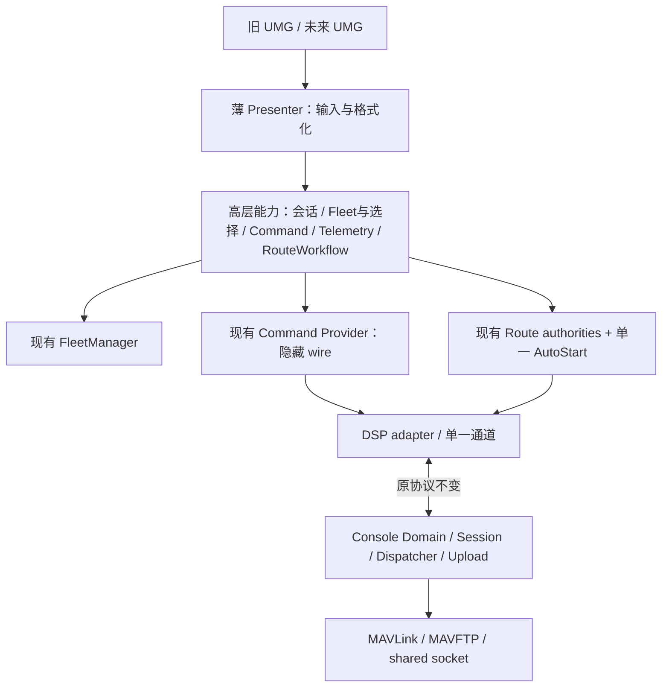

# 目标架构与最小 API

Status: PROPOSED，未实现；基线 `a95309d8`。用户确认前不开始 Phase 0。

## 1. 决策

优先采用轻量 Presenter + 现有 Subsystem 的应用 API，不立即引入 UE MVVM 插件、不建立五套 Manager。理由是当前稳定行对象、事件委托、无状态 Presenter 和 subsystem 已存在；核心问题是操作状态在 UIBridge/Coordinator，增加绑定框架不能自动解决。UE MVVM 可在未来新 UI 单页试点时再评估；本轮不作外部产品版本判断。

这是逻辑边界，不要求每个方框新增类。不把 Console DroneSession 暴露为 UE UObject Session，也不将远端状态重新本地计算。

## 2. 每次边界变化解决什么

| 当前 | 目标 | 解决的问题 | 保留 |
|---|---|---|---|
| Bridge拥有Widget和命令暂停/确认/聚合 | Widget适配调用一个无控件操作入口 | 新UI不需复制安全交互规则 | 原 UFUNCTION、结果格式和gate顺序 |
| Command选择藏在旧UI bridge | 先由稳定API委托现有集合；必要时一次迁移存储 | 不依赖旧主Widget存在 | 只有一个集合，旧Bridge转发，禁止双写 |
| Coordinator.inl含事务和控件 | 独立实现单元，后将展示投影分离 | 关闭/替换View不影响任务 | AutoStart/ConfirmedMapping Owner不复制 |
| UI读取DSP mirror和状态数字 | Route应用快照/typed presentation | 新UI不需DSP header | revision/token/identity仍在原adapter |
| Filter读取TelemetryProvider表格 | 协议无关只读Telemetry查询 | 表格不决定通道生命周期 | 一份权威来源，未知/过期原语义 |
| TelemetryProvider拥有通道和格式化 | 内部纯投影helper；对外Session health/API | 网络实现不传播至View | 单socket、接收线程和发送顺序 |
| 公共Build暴露大量模块 | 验证后收窄Private依赖 | 可编译检查边界 | 不改反射名、资源路径或协议 |

## 3. 五类能力的最小合同

以下是概念 API，不是要求直接创建这些名字。最终反射命名需在实现 Phase 审查已有 Blueprint 引用。

| 能力 | 最小读取/操作 | 现有来源 | 不能泄漏 |
|---|---|---|---|
| Session | Console连接状态、数据新鲜度、功能可用性事件 | ProductionTelemetry link health | Socket/port/ReceiveHandler；不新增Connect功能 |
| Vehicle/Selection | 完整Fleet、单机详情、详情选择、命令选择集合/原子替换、mutation gate | FleetManager + 当前Bridge选择 | 把详情当命令目标、自动全选 |
| Command | 已有动作提交、原参数校验、按request/target结果和can-execute原因 | Provider + 从Bridge迁出的策略 | MAV_CMD/ACK packet、retry操作、原始SendFrame |
| Telemetry | 最新标准状态、#187扩展状态、valid/fresh/source元信息 | Fleet + 表格投影 | 原始MAVLink/DSP DTO；不伪造缺失armed/姿态/速度 |
| Mission/Route | Import/Preview/Playback、稳定capture/确认映射、生成、上传/暂停/恢复/取消/重试、进度 | 既有Route各Authority + Coordinator | Arbitrary file path bypass、直接Freeze后发包、raw job mirror |

同一按钮的生命周期：输入 → 应用层校验原目标与门禁 → 原Provider提交 → 接收语义结果 → Presenter显示。UI不自行重试命令。新UI可以完全替换WBP，但运行期仍必须创建应用层所需Subsystem；不得通过删全部UI同时销毁操作状态。

“StopMission”不能作为一个含糊总入口：Upload Cancel、NPZ Stop、EndDanceStep、Land 是不同动作，继续独立命名。命令 API 使用逻辑 DroneID；网络 Endpoint只在底层校验或诊断投影，不成为UI提交参数。

## 4. 状态与结果合同

Command状态区分本地拒绝、已发送、飞控接受、遥测确认、受理工作流、拒绝、超时、模拟；这是一层对既有结果的表达，不增加ACK、不把旧Sent改为等待ACK。保留现有字符串字段/Blueprint接口，内部typed转换可逐步引入。

暂停资格和确认窗口不能从Widget可见性推导；ConfirmedMapping仍有其独立目标集合语义。每次迁移明确旧Owner何时停止写入，再由新入口代理，禁止新旧状态同时有效。

## 5. 不拆与可延后

不拆 Fleet identity、Session生命周期、shared socket、MissionFtpCompiler唯一planner、RouteAssignment唯一Owner、Niagara批量渲染。Console全目录重排、通用日志框架、Shared独立静态库、全面MVVM、Hover线程调度替换均可延后，且后者涉及行为时序需单独授权。

## 6. UI可替换验收

未来增加不加载旧WBP的测试调用者，使用同一应用入口完成选择/模拟命令/结果读取/Route只读状态；必须零真机发包。新Presenter编译依赖不包含DSP/MAVLink/socket headers，不构造wire ID、不管理retry。旧 authored UI 回归继续通过，关闭/重建View不能重发Start或丢失暂停/选择/任务状态。
