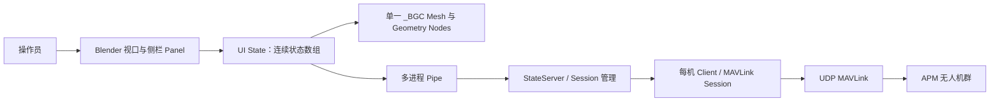
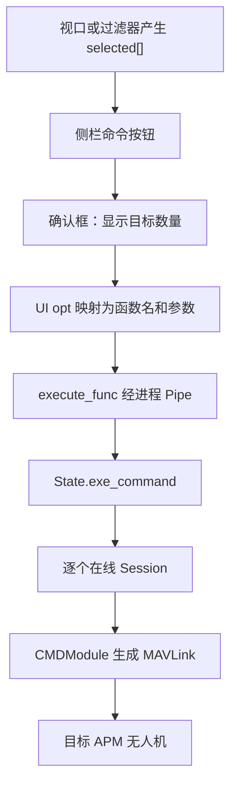
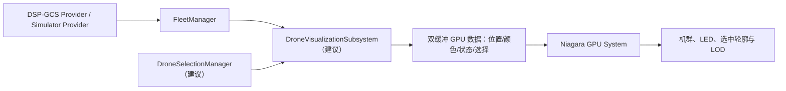
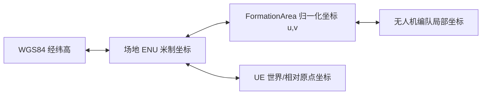
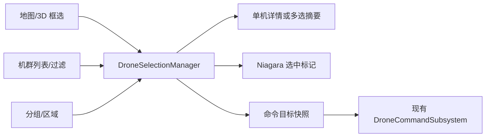
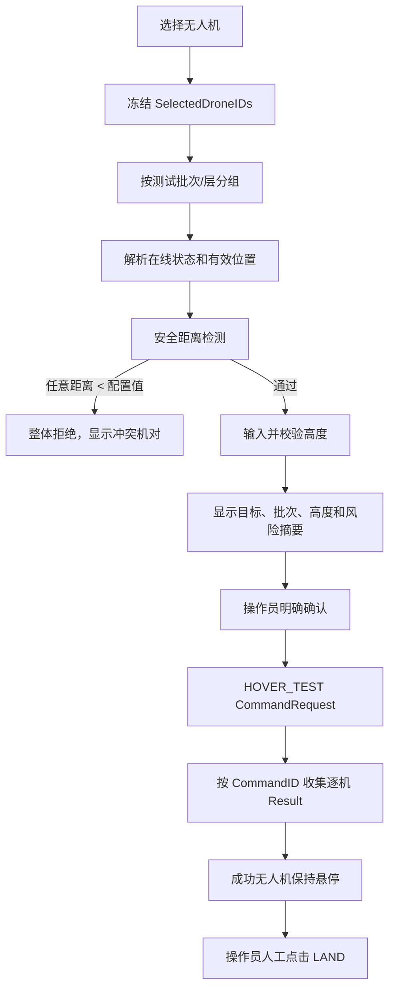
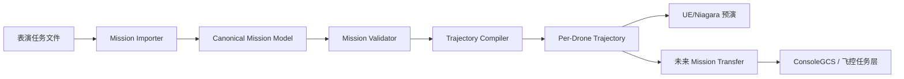
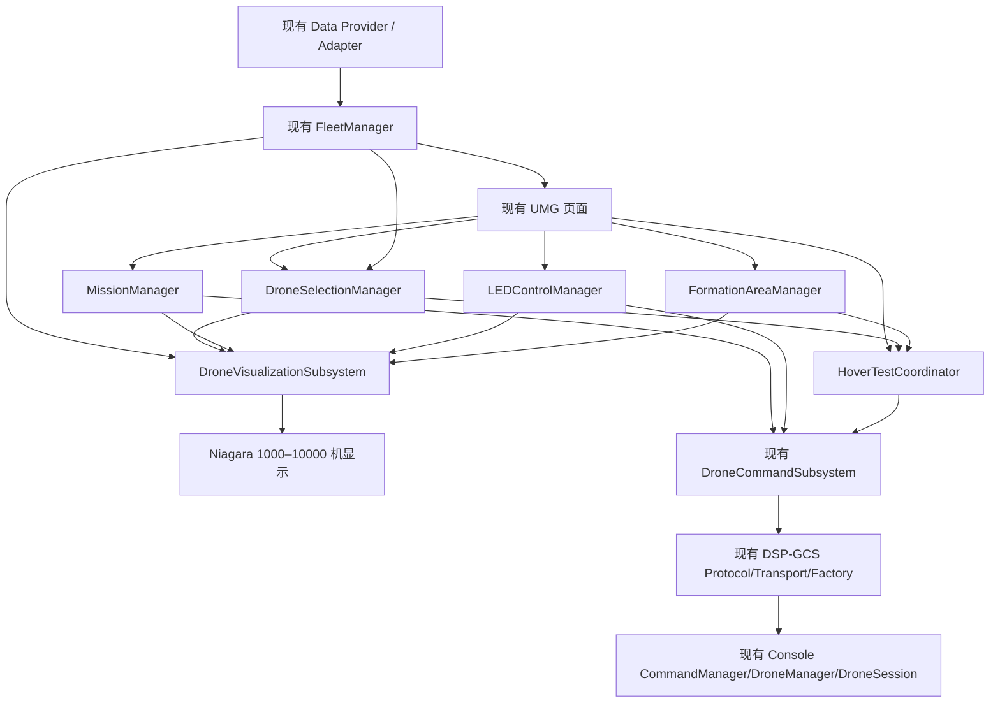

# Blender 旧无人机地面站参考分析

> **Status: HISTORICAL**
>
> **Authority: None for current architecture**
>
> **Last Updated: 2026-08-14 (classification only)**
>
> **DO NOT USE AS CURRENT ARCHITECTURE**
>
> Superseded by [Architecture_Freeze_CN.md](../Architecture_Freeze_CN.md), [Code_Architecture_CN.md](../Code_Architecture_CN.md), and [Development_Status_CN.md](../Development_Status_CN.md). Route-upload evidence is superseded by [Audit_Legacy_BGC2_RouteUpload_CN.md](Audit_Legacy_BGC2_RouteUpload_CN.md).

> 文档性质：旧系统业务参考与 UnrealGCS 模块规划，不是迁移方案。  
> 分析对象：`D:\Download\重要资源存储\bgc2\bgc2`、`simulator.blend`。  
> 当前项目：`UnrealGCS`、`ConsoleGCS`。  
> 分析日期：2026-08-04。

## 0. 结论摘要与边界

旧项目本质上是一个嵌入 Blender 3D 视口的无人机表演地面站插件。它将地图瓦片、无人机批量可视化、MAVLink 通信、状态筛选、任务转换与上传、表演控制和 LED 控制集中在 Blender 插件中。

最值得复用的是业务流程和批量处理思想，而不是 Python 实现：

- 地图采用 25 个二维瓦片平面，而不是三维地形。
- 无人机并非“一机一个 Blender Object”。运行时创建一个包含 N 个点的 `_BGC` Mesh，由 Geometry Nodes 在点上实例化无人机，并通过批量属性数组更新位置、颜色、状态和选中态。
- MAVLink 侧按无人机维护独立 `Client/Session`，UI 侧则使用固定长度、连续数组批量同步数据。
- 选择体系同时支持 Blender 视口单选/框选，以及全选、ID、遥测过滤、层、边缘点、围栏和备用机等业务筛选。
- 表演任务以 NPZ 中的逐帧位置和颜色为输入，转换为逐机 `.waypoints` 文件，再并发上传。
- LED 颜色是无人机真实灯光指令/任务数据，不是 UI 在线、告警等状态色。

本次分析严格遵守以下边界：

- 不迁移 Blender Python 代码。
- 不以 Blender 架构替换 UnrealGCS 当前架构。
- 不修改 DSP-GCS Protocol、Transport、Factory、FleetManager、CommandManager、DroneSession。
- 本文提出的新模块均是未来设计建议；没有实施，也不意味着当前阶段立即创建。

## 1. 旧地面站整体功能

### 1.1 运行结构

旧系统把产品 UI 放在 Blender 的 3D Viewport 和侧边栏 Panel 中。`BGC_PT_Server`、`BGC_PT_Console`、无人机详情、地图、过滤器、FTP 文件浏览器等面板共享同一个场景状态；中央 3D 视口同时承担地图、机群和任务预览。



通信端采用多进程：UDP 接收、多个 MAVLink parser、pipe 合并、状态服务相互分离。解析进程数量按 `count // 2000 + 1` 创建，说明旧系统已经主动考虑大机群解析吞吐；但 UI、通信、命令和任务职责仍存在明显耦合，不适合作为 UnrealGCS 的直接代码基础。

### 1.2 地图显示方式

`maps.py` 与 `tile_maps.py` 实现二维在线瓦片地图：

- 支持 Bing/Google，以及卫星图、道路图、标签等组合。
- 使用 5 × 5、共 25 个 256 像素瓦片；中央 3 × 3 优先加载。
- `simulator.blend` 中 `_MAPS` 场景实际包含 `tile_1` 至 `tile_25` 的 25 个四顶点 Mesh、中心控制对象 `_MAPS_L` 和缩放对象 `_MAPS_S`。
- 地图图像下载到缓存，随后替换各平面的图像资源。
- 缩放级别约为 1–23，鼠标滚轮可以驱动瓦片级别更新。
- 地图是铺在局部平面上的二维影像，不包含 Cesium 世界地形高度。

经纬度和局部坐标使用地球半径 `6378137 m` 的局部切平面近似：局部 X 向东，Y 向北，Z 为高度。该方法适合表演场地这种数公里范围，但不能直接承担全球尺度转换。

对 UnrealGCS 的启示是：表演控制视图可以保留“二维正射/卫星影像＋局部 ENU 坐标”的工作模式；Cesium 可继续负责地理参考和资源能力，但无需把三维地形作为机群编排与安全计算的坐标基础。

### 1.3 无人机显示方式

旧系统不是每架无人机一个 Blender Object，也不是传统粒子系统：

1. 从 `simulator.blend` 追加 `_BDS` 模板对象。
2. 在 `CreateArray` Geometry Nodes 修改器中设置无人机数量。
3. 应用修改器，得到含 N 个点/顶点的单一 `_BGC` Mesh。
4. 在点域保存 `position`、`color`、`selected`、`status`、`id` 等批量属性。
5. `BDS_MDFI` Geometry Nodes 在点上实例化 Ico Sphere/无人机显示，并根据状态、颜色、选中态、层和围栏属性改变可视结果。
6. UI 定时器通过 `foreach_set` 一次写入整列属性，不逐机调用对象 API。

`simulator.blend` 中可确认的节点组包括 `CreateArray`、`BDS`、`Layer Split`、`.fence`、`.Nearest Index`、`.UAV ID` 和 `RGB_TO_INT`。这一设计与未来 Niagara 的“一个批量渲染系统＋每机结构化数据”高度对应。

数量显示方面，旧 UI 汇总 Online、Checked、Selected 和任务运行时间，并可在视口绘制每个点的 ID；单机详情通过当前索引读取连续状态数组的一段数据。

### 1.4 无人机选择方式

旧系统具有多条选择路径：

- 在 `_BGC` Mesh 编辑模式中使用 Blender 原生点选择，因此天然支持点击单选、Shift 多选、框选、圈选和全选。
- 按无人机 ID 文本列表选择。
- 按任意遥测字段进行 `<`、`=`、`>` 过滤，并支持阈值和交/并组合。
- 选择全部在线机、清空选择、固定过滤结果。
- 按轨迹层 `layer` 选择。
- 选择任务的极值/边缘无人机。
- 按几何对象属性或围栏结果选择。
- 标记和排除备用机 `spare`。

最终选择统一落入长度为机群容量的布尔数组 `selected[]`。命令下发时将这个数组传到后端，后端遍历有效在线 Session 执行。这说明“交互如何选中”和“命令作用于谁”在数据上已经部分解耦，但仍缺少不可变目标快照、稳定 DroneID、权限校验和命令审计。

### 1.5 UI 布局

旧系统不是独立商业软件式布局，而是 Blender 工作区式布局：

- 中央：3D 视口，显示二维地图、机群、ID、围栏和任务预览。
- 侧栏：服务器、悬停测试/任务上传、表演控制、灯光、单机详情、参数、过滤器和文件管理。
- 操作模式：先在中央视口或过滤器选择，再在侧栏对当前选择下发命令。
- 危险命令：弹出确认框并显示选中数量；全机广播模式重复显示警告。

这一交互逻辑值得保留，但不应照搬 Blender Panel 的密集布局。UnrealGCS 应继续采用现有主界面、页面切换和可维护 UMG 资产；未来将“选择上下文、目标数量、风险等级、逐机结果”作为跨页面一致信息展示。

### 1.6 控制流程

旧系统的典型控制链路如下：



支持的业务动作包含解锁/上锁、GUIDED 起飞、LAND、RTL、STABILIZE、AUTO、表演步开始/结束、任务暂停/前后播放、速度、LED、烟花、数据流、重启和电源等。本文只将它们作为产品功能参考，不建议提前扩大当前 ConsoleGCS 已定义的命令范围。

## 2. 面向 1000–10000 架的 Unreal Niagara 显示方案

### 2.1 设计目标

Niagara 只负责高吞吐可视化，不成为无人机状态真源、命令目标真源或安全判断真源。现有 FleetManager 仍是 UE 内部机群显示数据的权威入口；未来通过独立可视化适配模块把批量快照转换成 Niagara 能消费的紧凑缓冲区。



### 2.2 推荐的数据布局

为活跃无人机维护连续 `VisualIndex`，并维护 `DroneID -> VisualIndex` 映射。每个可视实例至少需要：

- `PositionLocal`：局部 ENU/表演区域坐标，建议双精度在 CPU 保存，上传 GPU 前转相对原点的 float。
- `PreviousPosition` 与遥测时间：供平滑插值，不能直接用渲染帧位置作为真实状态。
- `LEDLinearRGB`、`Brightness`、`PatternIndex`。
- `OperationalFlags`：在线、故障、备用、任务、选中、告警等位标志。
- `DroneIDHash` 或 picking ID；真实 DroneID 仍留在 CPU 映射中。
- `Heading`、显示尺度和 LOD 标志（需要时再加）。

更新应使用 Delta Batch 合并后一次上传，采用双缓冲或环形缓冲，避免每架无人机每帧调用 Niagara 参数接口。UI 列表也不能每次复制完整 `TMap`；可见行使用虚拟化列表并只订阅增量。

### 2.3 渲染分层

- 近距离：低面数无人机 Mesh Renderer，可显示机头方向。
- 中距离：Billboard/Sprite，主要展示 LED 颜色与选中状态。
- 远距离：单像素或小光点，仅保留灯光和告警优先级。
- 选中与告警：使用独立 emitter 或额外标志渲染外圈，禁止覆盖真实 LED 颜色。
- 标签：只为少量选中、告警或鼠标附近无人机绘制 ID；不能为 10000 架常驻创建 UMG Widget Component。

### 2.4 选择与拾取

不要依赖 Niagara 粒子碰撞逐个选取。推荐：

- CPU 维护二维/三维空间索引，用于框选、半径选择、区域选择和最近点查询。
- 单击可使用 GPU ID Buffer 或屏幕射线附近的空间索引候选集。
- 选择结果必须转换成稳定的 DroneID 集合，而不是 Niagara 粒子索引；粒子索引可因压缩、离线或 LOD 变化而改变。
- 框选时只更新选择 Delta，避免每次复制 10000 个布尔值。

### 2.5 性能验收建议

未来实现时应分别压测 1000、3000、10000 架，并记录：

- 遥测输入频率与每秒 Delta 数。
- FleetManager 合并耗时。
- CPU 到 GPU 上传字节数和耗时。
- Niagara GPU 时间。
- 框选 10000 架时的查询时间。
- UI 虚拟列表刷新时间。
- 世界原点/地理参考变化后的抖动和精度。

初步目标可设为：普通工作站在 10000 架、10 Hz 遥测输入下仍保持 UI 可操作，渲染以 30 FPS 为最低目标；最终指标必须用目标部署硬件实测确定，不能仅凭设计承诺。

## 3. 无人机矩阵区域 FormationArea

### 3.1 旧系统中的实际做法

旧代码中没有发现明确命名为左上、右上、左下、右下的四角业务模型。现有相关能力是：

- `benchmark` 保存每架无人机的初始局部 X/Y，用距离阈值把实际无人机匹配到编队编号。
- NPZ 任务包含逐帧 `position`。
- `get_edge()` 在整个任务位置数据中分别查找 X/Y/Z 的最大值和最小值，得到 6 个“极值无人机索引”，存入 `wp_edge`。
- 过滤器的 Edges 功能选择上述极值无人机。

因此，不能把旧 `wp_edge` 解释成四个角：它是三个坐标轴的正负极值索引，可能重复，也可能来自不同帧。未来四角区域应作为新的一等业务模型建立。

### 3.2 建议模型

```text
FormationArea
{
    AreaID
    CornerLT
    CornerRT
    CornerLB
    CornerRB
    GeoReferenceOrigin
    LocalOrigin
    LocalAxisX
    LocalAxisY
    WidthMeters
    HeightMeters
    Revision
    Valid
}
```

每个 Corner 同时保存或可确定：

- WGS84：Latitude、Longitude、Altitude。
- UE 世界坐标：`FVector3d`，用于与 Cesium Georeference/大世界坐标配合。
- 区域局部坐标：以米为单位，X 向右/东向分量，Y 向上/北向分量，Z 为高度。

### 3.3 四角判定规则

“左/右/上/下”必须相对于 FormationArea 自己的局部坐标系定义，不能依赖当前摄像机朝向：

1. 操作员按 LT → RT → RB → LB 的固定顺序录入，或录入四点后由系统排序。
2. 建立区域 X 轴（LT → RT）和 Y 轴（LB → LT）。
3. 将四点投影到本地 ENU 平面，校验顶点顺序、凸性、边长、面积和是否自交。
4. 若自动排序，按中心点极角排序后，再利用局部 X/Y 极值确定名称。
5. 保存 AreaID 与 Revision；任务必须记录使用的区域版本，防止场地调整后旧任务静默错位。

### 3.4 坐标转换

推荐转换链：



- WGS84 ↔ ENU：使用可靠地理参考实现；旧系统的球面近似仅作为旧行为说明。
- 矩形区域：可采用二维仿射变换。
- 一般凸四边形：由四角执行双线性插值；逆变换使用数值求解或预先构建的稳健映射。
- UE 渲染：用相对 FormationArea 原点的局部 float 上传 Niagara，以降低大坐标精度损失。
- 安全计算：始终在米制 ENU/Formation 局部坐标上执行，不在屏幕坐标、经纬度度数或 Niagara 粒子位置上执行。

建议由未来 `FormationAreaManager` 管理区域定义和转换；Cesium 只提供地理参考能力，不让 Widget 或 Niagara 各自实现一套转换公式。

## 4. 无人机选择系统

### 4.1 旧系统结论

旧系统支持：

- 单选：Blender 点选择或过滤结果单项勾选。
- 多选：Shift/框选/圈选、结果勾选、ID 列表。
- 批量选择：全在线、按属性、按层、任务极值、围栏、对象属性。
- 排除：离线机和备用机可从结果中剔除。

但旧系统的 `selected[]` 主要以数组索引为身份，易受重编号和在线列表变化影响；命令执行时也直接读取可变选择数组。这种方式不能直接用于商业化大机群命令审计。

### 4.2 建议的 DroneSelectionManager

```text
DroneSelectionManager
    SelectedDroneIDs : Set<DroneID>

    SelectSingle(DroneID)
    ApplySelection(DroneIDs, Replace/Add/Remove/Toggle)
    SelectByRectangle(ScreenRect)
    SelectByFormationArea(AreaID)
    SelectByFilter(FilterExpression)
    SelectGroup(GroupID)
    ClearSelection()
    CreateImmutableSnapshot()
```

核心约束：

- 对外输出 `SelectedDroneIDs[]`，DroneID 是稳定业务 ID，不是 `TMap` 迭代位置、数组下标或 Niagara Index。
- `Selected` 不应成为 Widget 私有状态；Widget 只发选择意图并订阅选择变化。
- FleetManager 保留无人机数据职责；SelectionManager 只保存选择集合和选择上下文，不复制整份遥测。
- 下发命令前创建不可变目标快照，同时保存选择来源、操作者、时间、过滤条件和目标数量。
- 机群状态变化不会悄悄把新上线无人机加入已确认命令；若业务需要动态 Group/Fleet 目标，应由命令模型显式表达。
- 大规模变更广播 Added/Removed Delta 和汇总数量，避免每次复制 10000 个 ID 给所有 Widget。

### 4.3 与界面的关系



## 5. 悬停测试流程

### 5.1 旧流程

旧服务器面板的 Hover Test 区域提供：高度、按层拆分、层号、Unlock、Lock、Takeoff、Landing 和 Manual Route。起飞最终映射为 GUIDED 模式并携带高度；降落映射为 LAND。操作前会确认目标数量。

在已检查代码中没有发现“选中无人机两两距离小于阈值则阻止悬停测试”的完整安全校验。`prefs.threshold` 用于无人机与 benchmark 位置匹配，不应误认为悬停安全距离。

### 5.2 UnrealGCS 未来流程



安全规则：

- `MinimumHoverTestSeparationMeters` 是可配置参数，当前默认建议值为 `0.3 m`，不是散落在 UI/蓝图中的固定常量。
- 任何待测试无人机间距离 `< 0.3 m` 时，不下发该批次悬停测试命令。
- 无有效位置、位置过期、坐标系不一致或区域版本不一致，也应判定为不可测试，而不是跳过该机继续。
- 安全检查应在独立业务协调层完成，并由 Console/服务端再次校验；Niagara 显示距离不能作为唯一安全依据。
- 第一阶段悬停测试完成后不自动 RTL，成功无人机保持悬停，等待操作员人工点击降落。
- 危险命令不做自动重试；超时、部分成功、拒绝和未知结果必须逐机显示，并允许操作员基于当前真实状态作后续决策。

建议未来新增 `HoverTestCoordinator` 组织流程，但命令仍进入现有 DroneCommandSubsystem → DSP-GCS → Console CommandManager，不绕过已有安全与命令架构。

## 6. 表演任务系统

### 6.1 旧系统已有能力

旧项目存在较完整的表演任务雏形：

- 输入 NPZ 文件，至少包含 `position`、`color`，并使用帧区间数据。
- `position` 形状可还原为 `[Frames][Drones][XYZ]`。
- `color` 可还原为 `[Frames][Drones][RGBA]`。
- 按地图原点把局部位置转换成 WGS84。
- 转置数据后为每架无人机生成独立的 `<index>.waypoints`。
- 输出为 `QGC WPL 110` 格式，并将帧索引、RGB 和位置组合到任务行。
- 对选中无人机检查任务文件是否存在，再通过 Mission/FTP 能力并发上传；有上传并发数、进度、取消、超时和存储空间处理。
- 控制台包含开始/结束舞步、定时开始/停止、速度变化、任务暂停、前进/后退和返航/降落等表演操作。
- `MISSION_CURRENT` 提供当前序号和总数，UI 可显示运行时间和进度。

旧系统的优势是“逐帧编舞数据 → 逐机可执行任务”的完整链路；不足是文件格式、转换、上传、运行控制和 UI 高度耦合，且任务版本、签名、区域版本和统一验证模型不够清晰。

### 6.2 建议的 MissionManager 边界



`MissionManager` 输入表演任务文件，输出稳定的 `Trajectory`，建议的规范化数据至少包含：

- MissionID、Version、ContentHash、CreatedAt。
- FormationAreaID、FormationAreaRevision、坐标系和时间基准。
- DroneID/Role 到轨迹的映射。
- 每个轨迹点的 Time、Position、Velocity/Acceleration（若文件提供）、Yaw。
- 每个时刻的真实 LED 目标。
- 起飞前、表演、收尾和回收阶段标记。
- 备用机映射与替换约束。

验证器至少检查：

- 数量、DroneID 和区域版本一致性。
- 高度、速度、加速度、地理围栏。
- 同时刻和时间区间的机间距离。
- 轨迹连续性、任务时长和时间单调性。
- LED 数据范围。
- 缺失任务、重复身份和不可用备用机。

MissionManager 不应直接生成 MAVLink 包。任务编译器输出与飞控无关的轨迹/任务 DTO，后续由独立适配器转换成目标飞控支持的 Mission 格式。这样可继续支持 APM，也可在未来加入模拟器或其他飞控，而不污染 UE 任务模型。

## 7. LED 灯光系统

### 7.1 旧系统逻辑

旧系统的颜色有两条业务路径：

- 实时灯光：操作员选择颜色或调色板，`send_color` 通过 MAVLink `LED_CONTROL` 把 RGB 发给选中无人机。
- 表演灯光：NPZ 中逐帧 RGBA 被转换并写入每架无人机的任务文件，与轨迹帧共同执行。

旧 UI 会把选择的预览颜色写入 `_BGC` 点属性，使视口显示预期灯色。遥测接收中的 `LED_CONTROL` 回读代码处于注释状态，因此旧界面颜色更接近“已下发/预演目标”，不一定是飞控确认后的实际灯色。

### 7.2 未来 LED 数据模型

基础字段应包含用户指定的：

```text
DroneLEDCommand
{
    DroneID
    RGB
    Brightness
    Pattern
}
```

商业软件建议继续补充 `CommandID`、EffectiveTime/MissionFrame、Duration、Source、Requested、Acknowledged、Applied/Unknown 和 Error。尤其要区分：

- `RequestedLED`：任务或操作员希望显示的颜色。
- `AcknowledgedLED`：控制端已确认接收的颜色。
- `ActualLED`：只有硬件能可靠回报时才表示真实执行状态。
- `OperationalStatusColor`：UI 的在线、告警、选中颜色，绝不能覆盖或冒充无人机 LED。

Niagara 中应同时保留 LED 渲染通道和状态/选择轮廓通道。例如无人机灯点仍显示真实 LED 目标，离线状态用外圈、图标或透明度表达，而不是把灯点直接改成灰色导致编舞预览失真。

未来可规划独立 `LEDControlManager`，但它仍通过现有命令与协议层提交请求；MissionManager 管理时间化 LED 轨道，LEDControlManager 管理实时调试与批量灯光命令，两者共享同一个 LED 值对象和审计结果模型。

## 8. 旧系统功能到 UnrealGCS 的模块映射

| 旧系统功能/实现 | 旧代码或资产 | UnrealGCS 当前/未来对应模块 | 处理原则 |
|---|---|---|---|
| Blender 中央视口＋侧栏 Panel | `bgc.py`、`console.py`、`drone.py` | 现有 `WBP_GCS_Main`、页面 Widget、工具栏 | 只借鉴“选择后操作”的流程，不复制 Blender UI |
| 25 块二维地图瓦片 | `maps.py`、`tile_maps.py`、`simulator.blend/_MAPS` | 现有地图页面；未来 Map/GeoReference 服务 | 保留二维作业地图思路，坐标转换集中管理 |
| 经纬度与局部坐标转换 | `Maps.local_to_wgs84`、`State.get_local/get_gps` | 未来 `FormationAreaManager`/GeoReference Adapter | 不在 Widget、Niagara、任务模块重复公式 |
| 单 Mesh＋Geometry Nodes 批量显示 | `_BGC`、`CreateArray`、`BDS_MDFI` | 未来 `DroneVisualizationSubsystem`＋Niagara | 用批量缓冲和 LOD，不创建 10000 个 Actor/Widget |
| 连续状态属性数组 | `Info`、UI `State`、`foreach_set` | 现有 Provider → `FleetManagerSubsystem` → UI Bridge | 保留批量 Delta 思想，不让协议 DTO 等同飞控内部对象 |
| 每机 MAVLink 客户端 | `session.py Client`、`state.py sessions[]` | ConsoleGCS 现有 `DroneManager`/`DroneSession` | 仅作能力参考，不修改现有类 |
| UDP/Parser/State 多进程 | `worker.py` | ConsoleGCS 通信与服务部署层 | 不并入 UE，不绕过 DSP-GCS Transport/Factory |
| 视口单选/框选 | `_BGC` Mesh Edit Mode | 未来 `DroneSelectionManager`＋地图/Niagara 拾取 | 输出稳定 `SelectedDroneIDs[]` |
| 全选、ID、属性、层、围栏筛选 | `filter.py` | 未来 Selection Query/Filter Service、机群页面 | 筛选产生选择意图，不直接持有飞控状态 |
| 备用机标记与排除 | `state.spare`、`BGC_OT_Spare` | 未来 Fleet Role/Replacement Manager | 备用身份属于业务数据，不是渲染属性 |
| 轨迹极值机选择 | `get_edge()`、`wp_edge` | 未来 Mission Analysis/Selection Query | 不等同 FormationArea 四角 |
| 基准点与编号匹配 | `benchmark`、`index_check/set_index` | 未来 Formation Assignment/Identity Reconciliation | 身份匹配需要容差、冲突和审计结果 |
| Hover Test 面板 | `BGC_PT_Server` | 未来 `HoverTestCoordinator`＋现有 DroneCommandSubsystem | 0.3 m 可配置校验；完成后悬停，人工 LAND |
| 命令选中机群并下发 | `BGC_OT_command`、`State.exe_command` | 现有 DroneCommandSubsystem → DSP-GCS → Console CommandManager | 保持现有命令架构，增加业务协调而非旁路 |
| NPZ 轨迹/颜色转换 | `worker.transwp` | 未来 Mission Importer/Trajectory Compiler | 转换为规范任务模型，不让 UE 直接生成 MAVLink |
| 逐机 waypoint 上传 | `send_upload`、Mission/FTP | 未来 Mission Transfer/Deployment Service | 需要版本、哈希、进度、取消和逐机结果 |
| 表演时间、舞步、暂停、前后播放 | `console.py`、`commands.py` | 未来 Mission Runtime Manager | 使用统一时钟、状态机和审计日志 |
| 实时 LED 与任务 LED | `send_color`、NPZ `color` | 未来 LEDControlManager＋Mission LED Track＋Niagara | LED 与 UI 状态色严格分离 |
| 单机遥测详情 | `drone.py` | 现有 `WBP_GCS_DroneDetail`＋GCSUIBridge/FleetManager | Widget 只读取数据，不保存权威状态 |
| FTP 文件浏览与设备文件操作 | `explorer.py`、`mavftp.py` | 未来 Mission Asset/Device Maintenance 模块 | 与日常飞行控制分权并隔离危险操作 |
| 仿真客户端 | `simulator.py`、`mavclient.py` | 现有/未来 Simulator Provider | 通过 Provider/协议输入，不写入 FleetManager 特例 |

## 9. 建议的未来业务模块关系

以下是参考设计，不要求当前阶段创建：



## 10. 可复用产品思想、不可复用实现与优先级

### 可复用的产品思想

- 二维地图与局部米制坐标作为表演场地主要作业空间。
- 视图选择、业务筛选和批量命令的工作流。
- 单机详情与机群汇总并存。
- 逐机 Session、批量状态数组和批量显示。
- 轨迹与灯光同一时间轴的表演任务概念。
- 任务转换、校验、逐机部署、进度和取消。
- 备用机、围栏、边缘机、固定基准和分层测试等表演业务概念。

### 不应复用的实现

- Blender UI、PropertyGroup、Operator 和 Python 多进程代码。
- 用数组下标代替稳定 DroneID。
- UI 直接用函数名和参数列表映射 MAVLink 命令。
- 让地图、任务、飞控、上传和 UI 共享可变场景状态。
- 把显示颜色当作已确认的真实 LED 状态。
- 用全量数组和全量 Widget 刷新承载 10000 机 UI。
- 以轨迹六个极值点替代明确的四角 FormationArea。

### 建议后续分析/实施顺序

1. 先定义 FormationArea、坐标约定和区域校验文档。
2. 设计 DroneSelectionManager 接口和选择快照，不连接危险命令。
3. 用 Mock/Loopback 数据完成 Niagara 1000/10000 机显示与拾取性能原型。
4. 设计 HoverTestCoordinator 状态机，并实现 0.3 m 可配置安全校验的纯数据测试。
5. 定义规范化 Mission/Trajectory 文件模型，再编写旧 NPZ 的一次性导入器；导入器不是旧 Python 迁移。
6. 设计 LED 目标、确认和实际状态的三态数据模型。
7. 最后通过现有 DSP-GCS 命令链逐阶段接入，不更改 Protocol、Transport、Factory、FleetManager、CommandManager 或 DroneSession 的既定边界。

## 11. 分析证据索引

| 结论 | 主要证据 |
|---|---|
| 地图为二维瓦片平面 | `maps.py`、`tile_maps.py`；`simulator.blend` 的 `_MAPS` 场景和 `tile_1..tile_25` |
| 无人机为单 Mesh 批量点实例 | `bgc.py::BGC_OT_Server.add_model/modal`；`simulator.blend` 的 `CreateArray`、`BDS` 节点组 |
| 支持视口单选/框选 | `filter.py::Filter.update` 在 Edit Mode 读取 Mesh vertices 的 `select` |
| 支持多种业务筛选 | `filter.py::Filter.update` 的 all/picker/layer/edge/object/fence/spare 分支 |
| 每机独立 MAVLink Session | `state.py::State.sessions`、`session.py::Client` |
| 大批量解析设计 | `bgc.py::build_server`、`worker.py::parser/pipe_join/udp_start` |
| 悬停面板为人工起飞/降落 | `bgc.py::BGC_PT_Server`、`console.py::Command.get_cmd` |
| 未发现悬停距离安全校验 | 已检查 `bgc.py`、`console.py`、`commands.py`、`state.py`、`filter.py` 的悬停命令路径 |
| 任务含逐帧位置和颜色 | `worker.py::transwp`、`bgc.py::BGC_OT_WPTransform/BGC_OT_Send_upload` |
| LED 为真实灯光目标 | `commands.py::send_color` 使用 MAVLink LED_CONTROL；任务转换写入 RGB |
| `wp_edge` 不是四角 | `bgc.py::get_edge` 返回 XYZ 最大/最小值对应的 6 个索引 |

本文只记录通过源码和 `simulator.blend` 只读检查能够确认的事实。运行时依赖的真实无人机、外部任务文件、授权插件和现场业务配置未启动，因此涉及现场操作效果的结论均以代码路径为依据，仍需后续在隔离模拟环境中做行为复核。
