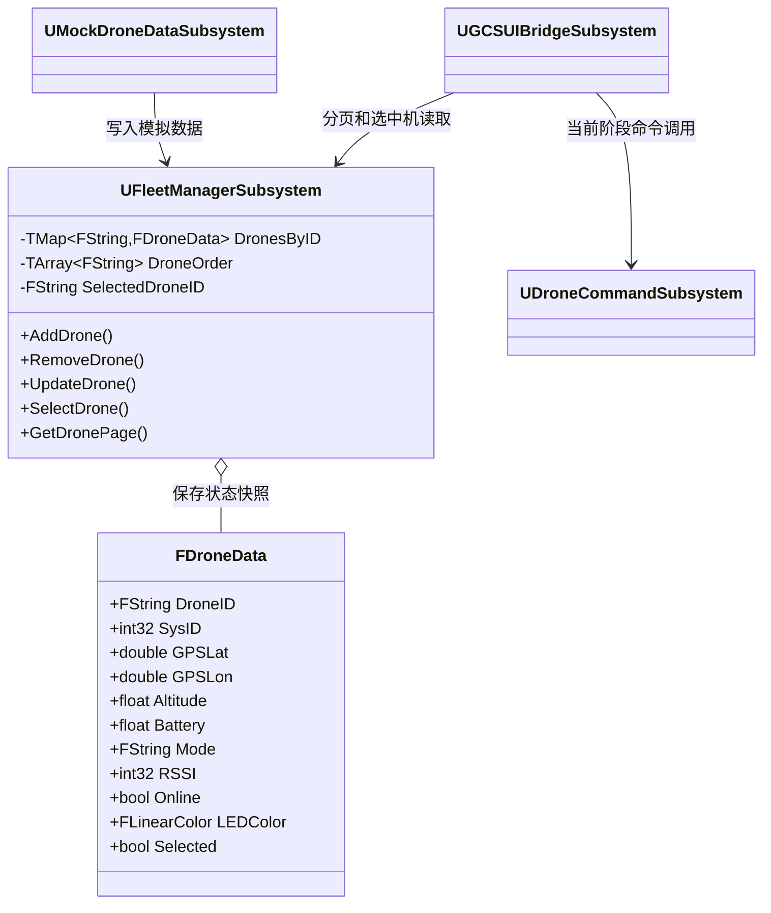
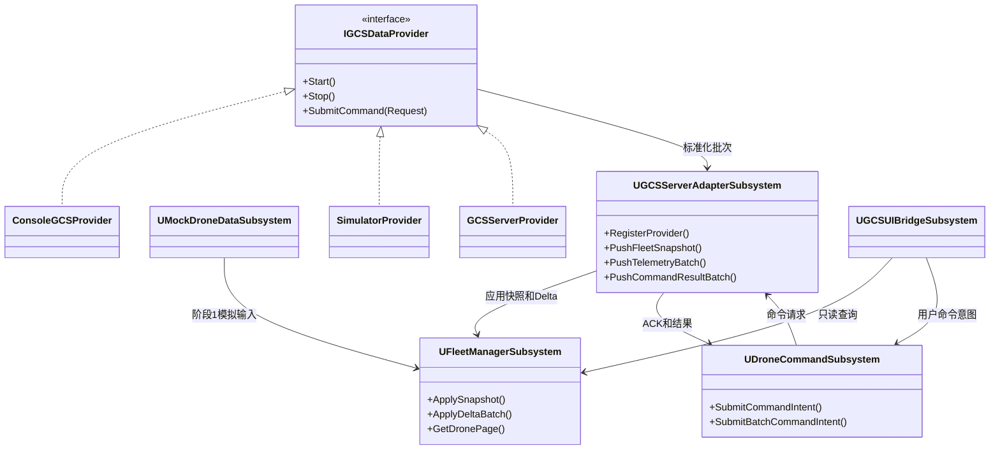
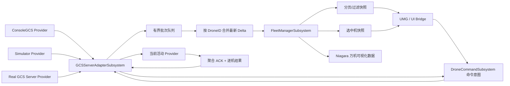

# DroneShowPlatform 无人机表演管理平台架构审查 V5.0

> **Status: HISTORICAL**
>
> **Authority: None for current architecture**
>
> **Last Updated: 2026-08-14 (classification only)**
>
> **DO NOT USE AS CURRENT ARCHITECTURE**
>
> Superseded by [Architecture_Freeze_CN.md](../Architecture_Freeze_CN.md), [Code_Architecture_CN.md](../Code_Architecture_CN.md), and [Development_Status_CN.md](../Development_Status_CN.md).

> 状态：阶段 1 完成后的只读架构审查  
> 日期：2026-08-03  
> 范围：UnrealGCS 数据层、FleetManager、未来数据输入接口与命令架构  
> 本文只提出设计建议，不代表相关类已经实现。

---

## 1. 项目定位与审查原则

DroneShowPlatform 不是普通游戏项目，也不是只面向单台无人机的地面站。

最终目标包括：

- 单台 APM 无人机控制；
- 3 机小规模联调；
- 1000 台无人机管理；
- 10000 台无人机灯光表演；
- 表演任务、Slot、LED、健康检测、故障替换和自动回收；
- 可部署、可审计、可扩展的商业软件架构。

所有后续设计遵守以下边界：

1. UI 只负责显示、编辑和用户意图，不保存权威无人机状态。
2. FleetManager 不解析 MAVLink，也不依赖 UDP、TCP 等传输协议。
3. 通信 Provider 不直接操作 Widget。
4. 命令、遥测、表演状态、LED 内容和故障状态语义分离。
5. 10000 台无人机不能对应 10000 个 Actor、线程或独立 UI Widget。
6. 高频数据必须批量处理、合并和限频发布。

---

## 2. 阶段 1 当前架构

### 2.1 已实现组件

| 组件 | 当前职责 | 审查结论 |
|---|---|---|
| `FDroneData` | UE 前端的一台无人机状态快照 | 适合阶段 1 显示，不足以表达完整表演领域状态 |
| `UFleetManagerSubsystem` | 按 DroneID 保存、查询、更新和选择无人机 | 容器基础正确，需要批量更新、二级索引和事件合并 |
| `UMockDroneDataSubsystem` | 向 FleetManager 写入 5 台本地模拟数据 | 与 FleetManager 解耦正确，未来可被其他 Provider 替换 |
| `UGCSUIBridgeSubsystem` | 从 FleetManager 读取数据并刷新现有 UMG | 已避免 Widget 保存状态，但当前固定 5 行不是最终机群列表方案 |
| `UDroneCommandSubsystem` | 现有 UDP 命令客户端、ACK、超时和旧遥测解析 | 可保留为阶段性兼容实现，不应成为最终通信或命令核心 |
| 网络配置开关 | 控制现有 UDP 客户端是否启动 | 阶段 1 默认关闭正确 |
| `SafeTestMode` | 真实控制安全开关 | 必须继续保留，并由服务端再次执行安全校验 |

### 2.2 当前类关系图



### 2.3 规模适配结论

| 目标规模 | 当前适配程度 | 结论 |
|---|---|---|
| 1 台 | 良好 | 可用于当前单机 UI 和后续命令联调 |
| 3 台 | 良好 | 当前容器和事件模型足够完成小规模测试 |
| 1000 台 | 有条件可用 | 必须增加批量更新、虚拟列表和 UI 限频 |
| 10000 台 | 仅具备基础方向 | TMap 容量可行，但当前状态模型和逐条事件模型不能直接投入万机表演 |

---

## 3. FDroneData 数据层审查

### 3.1 当前字段能够支持的范围

当前 `FDroneData` 可以表达：

- DroneID 与 MAVLink SysID 的基础身份；
- 经纬度和单一高度；
- 电池百分比；
- 文本飞行模式；
- RSSI 和在线状态；
- 一个 LED 颜色；
- 单选状态。

它适合作为阶段 1 的轻量 UI 快照，但还不能作为完整的 DroneSession、表演状态或安全决策模型。

### 3.2 建议补充的领域信息

以下内容只作为下一阶段设计建议，本阶段不修改结构。

#### 身份与绑定

- `ComponentID`；
- 稳定的设备序列号或 VehicleUID；
- `SlotID`；
- `GroupIDs`；
- 主力机、备用机、替换机角色；
- 数据来源和会话 ID。

`DroneID`、`SysID`、网络地址必须继续分离。SysID 在不同链路或会话中可能重复，不能作为全局唯一键。

#### MAVLink/APM 遥测

- Armed 状态；
- FlightMode 枚举和 APM CustomMode；
- GPS FixType、卫星数、HDOP；
- 相对高度、海拔高度、Home 高度；
- 地速、垂直速度、航向；
- Roll、Pitch、Yaw；
- 电压、电流、剩余容量和温度；
- EKF、罗盘、GPS、RC 和飞控健康状态。

#### 连接与数据时效

- `ConnectionState` 枚举，不能长期只使用 `bool Online`；
- 最后心跳时间；
- 最后遥测时间；
- 服务端时间戳、序列号和数据版本；
- Stale、Lost、Recovering 等状态；
- 延迟、丢包率和链路质量。

#### 安全与故障

- `HealthState`；
- `FaultFlags` 或故障代码集合；
- Failsafe 状态；
- Geofence 状态；
- PreArm 检查结果；
- 可起飞、可参演、需维护等 readiness 状态。

故障颜色和 LED 表演颜色必须分离。`LEDColor` 只表示表演内容，不能用红绿蓝表达健康状态。

#### 任务、测试与表演

- `MissionID`、MissionState、当前任务项和进度；
- TestState；
- ShowID、ShowState、当前 Frame 或时间码；
- SlotState 和替换状态；
- 期望 LED 与飞行器已确认 LED；
- 最后命令、ACK 状态及任务同步版本。

### 3.3 推荐的数据模型分层

不建议把所有未来字段无限加入一个巨大的 `FDroneData`。建议逐步拆分：

```text
FDroneIdentity
FDroneKinematics
FDronePowerState
FDroneLinkState
FDroneHealthState
FDroneMissionState
FDroneShowState
FDroneDataSnapshot
```

`FDroneDataSnapshot` 可以组合上述结构，作为 UE 的只读聚合快照。

### 3.4 Selection 的边界

当前 `bSelected` 对单选原型有效，但最终不应属于服务端权威无人机状态。

建议未来增加独立的 `UFleetSelectionSubsystem` 或 SelectionModel，内部使用：

```text
TSet<DroneID> SelectedDroneIDs
PrimarySelectedDroneID
SelectionRevision
```

这样才能支持单选、多选、框选、分组选择和区域选择，并避免为了改变选择而改写大量 DroneData。

---

## 4. FleetManager 大规模审查

### 4.1 TMap 是否适合 1000/10000 台

`TMap<FString, FDroneData>` 在 10000 台规模下仍然可用。

- 按 DroneID 查询：平均 O(1)；
- 更新已有无人机：平均 O(1)；
- 添加：平均 O(1)；
- 删除 TMap 项：平均 O(1)；
- 当前 `DroneOrder.RemoveSingle`：O(N)，但无人机删除通常不是高频遥测操作，可以接受；
- `GetDronePage` 只复制指定页面，方向正确。

主要瓶颈不会首先来自 10000 个 TMap 元素，而会来自遥测更新频率、字符串分配、逐条动态委托、UI 刷新和全量快照复制。

### 4.2 当前优势

- 没有为每台无人机创建 Actor；
- 没有为每台无人机创建线程；
- 使用稳定顺序数组，不依赖 TMap 的遍历顺序；
- UI 当前只请求 5 条数据，没有复制完整机群；
- FleetManager 不依赖 MAVLink 或网络地址；
- Mock Provider 已与 FleetManager 分离。

### 4.3 大规模风险

#### 整结构覆盖

当前 `UpdateDrone` 使用完整 `FDroneData` 覆盖已有状态。未来不同数据源可能只更新部分字段，整结构覆盖容易把其他模块刚写入的字段重置。

建议引入：

- `FDroneDataDelta`；
- 字段有效位或 UpdateMask；
- `ApplyTelemetryBatch`；
- SnapshotRevision 和 SourceTimestamp。

#### 逐条事件风暴

当前每次 `UpdateDrone` 都广播 `OnDroneUpdated`。如果 10000 台无人机以 10Hz 更新，理论上将产生每秒 100000 次广播，Blueprint 动态委托和 UI 无法承受。

建议：

1. 通信线程只向有界队列写入标准化批次；
2. 同一 DroneID 在一帧/一个时间窗内合并为最新状态；
3. FleetManager 一次应用一个批次；
4. UI 只接收 `FleetRevisionChanged`、可见页变化和选中机变化；
5. UI 刷新频率限制在 5～20Hz，不跟随每条遥测消息刷新；
6. 不使用 Widget Event Tick 发送命令或轮询状态。

#### 批量发现事件

当前逐台 `AddDrone` 会逐次广播 `OnFleetChanged`。10000 台启动发现时会产生 10000 次结构刷新。

建议增加：

- `AddOrUpdateBatch`；
- `ReplaceFleetSnapshot`；
- `BeginBatch/EndBatch` 或单次批量事务；
- 批次结束后只发布一次结构版本变化事件。

#### 二级索引

未来建议按实际查询场景增加二级索引：

- VehicleUID/SessionKey → DroneID；
- SysID + LinkID → DroneID；
- SlotID → DroneID；
- GroupID → DroneID 集合；
- Online、Fault、Backup、Selected 等过滤集合。

禁止通过每次遍历 10000 台无人机完成常用筛选。

#### UI 列表

当前固定 5 行只适合阶段 1。未来应使用 UMG `ListView`/`TileView` 虚拟化，只创建可见行 Widget，并通过分页、过滤和排序模型读取快照。

### 4.4 线程模型建议

- FleetManager 保持 Game Thread 所有权，不让网络线程直接修改 `TMap`；
- Provider/通信线程解析数据后写入线程安全有界队列；
- GCSServerAdapter 在受控时间点将批次投递到 Game Thread；
- 对积压数据采用同 DroneID 最新值覆盖，而不是无限增长队列；
- 命令 ACK、告警和状态遥测应使用不同优先级队列。

---

## 5. 下一阶段：GCSServerAdapterSubsystem

### 5.1 定位

`UGCSServerAdapterSubsystem` 是 UnrealGCS 的应用层数据端口，不是 UDP、TCP 或 MAVLink 客户端。

它只认识标准化 DTO：

- 机群快照；
- 遥测批次；
- 连接状态；
- 告警事件；
- 命令请求；
- 命令 ACK/ERR。

### 5.2 禁止依赖

GCSServerAdapter 不应包含：

- Socket 类型；
- IP 和端口解析；
- UDP/TCP 收发；
- MAVLink 消息 ID；
- APM 数据包解析；
- Widget 引用。

### 5.3 建议的标准化输入接口

以下为设计草案，不是本阶段代码：

```text
IGCSDataProvider
  Start()
  Stop()
  GetProviderState()
  SubmitCommand(FDroneCommandRequest)

Provider -> Adapter 输入：
  PushFleetSnapshot(FGCSFleetSnapshot)
  PushTelemetryBatch(FGCSTelemetryBatch)
  PushAlertBatch(FGCSAlertBatch)
  PushCommandResultBatch(FDroneCommandResultBatch)
  PushConnectionState(FGCSConnectionState)
```

Provider 实现可以是：

- `ConsoleGCSProvider`：早期连接现有 ConsoleGCS；
- `SimulatorProvider`：本地或外部模拟器；
- `GCSServerProvider`：未来商业 GCS Server；
- `ReplayProvider`：日志回放和事故复盘。

Provider 如何传输数据属于 Provider 内部实现，Adapter 和 FleetManager 不感知具体协议。

### 5.4 建议的数据 DTO

```text
FGCSMessageHeader
  SchemaVersion
  SourceID
  SessionID
  Sequence
  ServerTimestamp

FGCSFleetSnapshot
  Header
  FleetRevision
  Drones[]

FDroneDataDelta
  DroneID
  ChangedFields
  Payload

FGCSTelemetryBatch
  Header
  Deltas[]

FGCSCommandResultBatch
  Header
  CommandID
  AggregateResult
  PerDroneResults[]
```

所有消息必须有 SchemaVersion，保证未来 UE、ConsoleGCS 和商业服务器可以独立升级。

### 5.5 下一阶段类关系图



---

## 6. 命令架构规划

### 6.1 当前问题

当前 `UDroneCommandSubsystem` 同时承担：

- UI 可调用命令函数；
- UDP Socket；
- 文本协议序列化；
- ACK 和超时；
- 旧遥测解析。

它可以继续服务当前单机验证，但职责过多，不适合作为最终万机命令核心。

### 6.2 未来职责

未来 `UDroneCommandSubsystem` 应成为 UE 侧命令意图和状态协调器：

- 接受 ARM、DISARM、TAKEOFF、LAND、RTL、GUIDED 等用户意图；
- 构造标准化命令请求；
- 生成全局唯一 CommandID；
- 记录 Pending、Accepted、Executing、Partial、Succeeded、Failed、TimedOut；
- 把请求交给 GCSServerAdapter；
- 接收聚合结果和逐机结果；
- 不创建 Socket，不解析 MAVLink，不直接操作飞控。

### 6.3 命令目标模型

建议定义统一目标选择器：

```text
FDroneCommandTarget
  TargetType:
    SingleDrone
    ExplicitDroneList
    Group
    Area
    SlotSet
    EntireFleet

  DroneID
  DroneIDs[]
  GroupID
  AreaID
  SlotIDs[]
  FleetRevision
```

支持方式：

- 单机：一个 DroneID；
- 小批量：明确 DroneID 列表；
- 全机群：发送 `EntireFleet + FleetRevision`，不要由 UE 展开并发送 10000 个独立命令；
- 分组和区域：由服务端在同一权威 FleetRevision 上解析目标。

### 6.4 命令请求模型

```text
FDroneCommandRequest
  CommandID
  CommandType
  Target
  Parameters
  RequestedBy
  ClientTimestamp
  ExpectedFleetRevision
  SafetyContext
  IdempotencyKey
```

`TAKEOFF` 参数至少包含高度；未来测试命令应包含持续时间、测试组和恢复模式。

### 6.5 命令结果模型

```text
FDroneCommandResultBatch
  CommandID
  AggregateState
  RequestedCount
  AcceptedCount
  SucceededCount
  FailedCount
  PerDroneResults[]
```

批量命令必须允许 Partial Success，不能用单个 bool 表示 10000 台无人机的执行结果。

### 6.6 安全要求

- UE 的 SafeTestMode 是第一层保护，但不是唯一保护；
- GCS Server 必须再次检查权限、机群状态、飞行模式、GPS、地理围栏和 PreArm；
- ARM/TAKEOFF 等高风险命令必须有明确目标和审计记录；
- 不绕过 APM 安全检查；
- 自动测试默认只能使用模拟 Provider 或无动作命令；
- 非幂等飞行命令不能在未明确服务器语义时自动重试；
- Emergency Stop 必须定义准确语义，不能把强制 DISARM、LAND 和任务中止混为同一命令。

### 6.7 可配置安全测试距离

安全测试距离不得在 Widget、命令代码或飞行逻辑中写死。

统一定义配置语义：

```text
MinimumTestSeparationMeters
默认值：0.3 m
测试通过条件：实际距离 > MinimumTestSeparationMeters
```

因此，旧设计中的固定数值距离判断应统一更新为：

```text
距离 > MinimumTestSeparationMeters
当前默认配置 MinimumTestSeparationMeters = 0.3 m
```

该值属于可配置安全测试参数，而不是永久固定的业务常量。未来应由 GCS Server 的站点/机型安全配置提供，UE 只显示服务器下发的当前有效值。配置记录应包含版本、适用机型、场地、修改人和生效时间，并由服务端执行最终校验。

`0.3 m` 是当前项目默认测试配置，不代表所有机型和场地都可直接使用；正式商业部署前必须通过真机尺寸、桨叶范围、定位误差、气流扰动和现场安全规范验证。

#### 悬停测试准入规则

悬停测试开始前，SafetyManager 必须检查本次测试目标集合中所有无人机的两两距离。

```text
MinimumPairwiseDistance = 测试目标中任意两台无人机距离的最小值

允许悬停测试：
MinimumPairwiseDistance > MinimumTestSeparationMeters

禁止悬停测试：
MinimumPairwiseDistance <= MinimumTestSeparationMeters
```

在当前默认配置下：

```text
无人机间距 <= 0.3 m：不进入悬停测试
无人机间距 > 0.3 m：距离检查通过，可继续执行其他安全检查
```

距离检查通过不等于立即起飞。系统仍必须继续检查连接状态、GPS/EKF、飞行模式、电池、地理围栏、PreArm、权限和 SafeTestMode。任一检查失败都应拒绝悬停测试。

拒绝时应返回结构化结果，例如：

```text
Result: Rejected
Reason: SAFETY_DISTANCE_VIOLATION
RequiredDistanceMeters: 0.3
MeasuredDistanceMeters: 实测最小距离
ConflictingDroneIDs: 发生冲突的无人机编号
```

该检查必须由 GCS Server/SafetyManager 最终执行；UE 可以提前显示预检查结果，但不能成为唯一安全判断方。

---

## 7. 下一阶段数据流图



---

## 8. 风险列表

| 优先级 | 风险 | 影响 | 建议 |
|---|---|---|---|
| P0 | 每条遥测直接广播动态委托 | 万机时产生事件风暴，阻塞 Game Thread | 批量合并、限频发布、可见数据刷新 |
| P0 | UE 将全机命令展开为 10000 条单机命令 | 网络和 ACK 管理失控，目标集合可能不一致 | 服务端目标选择器和批量事务 |
| P0 | UI/客户端成为唯一安全检查点 | 可绕过、不可审计 | 服务端权限与 SafetyManager 强制校验 |
| P1 | FDroneData 缺少健康、任务、Slot 和时间戳 | 无法支持故障替换和表演同步 | 分层状态结构和版本化快照 |
| P1 | UpdateDrone 整结构覆盖 | 不同数据来源互相覆盖字段 | Delta + UpdateMask + 批量应用 |
| P1 | bSelected 混入权威 DroneData | 多选和框选会污染数据层并触发大量更新 | 独立 SelectionModel |
| P1 | SysID 被误用为全局身份 | 多链路或重连后发生错误映射 | VehicleUID/SessionKey 和二级索引 |
| P1 | 当前 DroneCommandSubsystem 绑定 UDP 和文本协议 | 无法平滑切换模拟器和商业服务器 | 命令协调器、Adapter、Provider 分层 |
| P1 | 固定 5 行机群 UI | 不能浏览 1000/10000 台 | ListView 虚拟化、分页、筛选和搜索 |
| P2 | FString DroneID/Mode 高频复制 | 增加分配与拷贝压力 | 稳定 ID、FName/枚举、共享快照 |
| P2 | DroneOrder 删除为 O(N) | 高频动态接入时有抖动 | 批量结构变更或稀疏/索引化顺序模型 |
| P2 | 缺少 SchemaVersion 和 FleetRevision | 客户端/服务端升级与批量命令目标不一致 | 所有 DTO 加版本、序列和时间戳 |
| P2 | 安全测试距离被写死 | 更换机型、定位系统或场地后无法安全调整 | 使用 `MinimumTestSeparationMeters`，默认 0.3 m，由服务端配置和校验 |
| P2 | 中文项目路径与 MSVC 14.44 构建兼容问题 | 商业 CI/CD 构建不稳定 | CI 使用纯英文规范路径和固定工具链 |
| P2 | 既有 Cesium/UnrealMCP 警告 | 引擎升级后可能变成错误 | 与核心业务分开排期治理，不在本阶段混改 |

---

## 9. 下一阶段目标与验收标准

### 9.1 下一阶段只实现的内容

1. 定义与协议无关的标准 DTO；
2. 定义 `IGCSDataProvider`；
3. 创建空的 `UGCSServerAdapterSubsystem`；
4. 让 Mock Provider 通过 Adapter 批量输入，而不是直接耦合 UI；
5. FleetManager 增加批量 Snapshot/Delta 接口与单次版本通知；
6. 定义单机、小批量和全机群命令请求/结果结构；
7. 保持网络关闭，不接 ConsoleGCS，不发送真实飞控命令。

### 9.2 暂不实现

- UDP/TCP/WebSocket；
- MAVLink；
- ConsoleGCS 真正连接；
- 自动发现；
- 真机 ARM/TAKEOFF；
- Niagara 万机渲染；
- ShowManager、SlotManager 和故障替换业务。

### 9.3 验收标准

- Adapter、FleetManager、UI 均不包含 MAVLink 或 Socket 类型；
- 同一批次 10000 条模拟 DroneData 可以一次提交；
- FleetManager 只发布一次批次完成事件；
- UI 只读取当前页和选中项；
- 切换 Mock/Simulator/Server Provider 不需要修改 Widget；
- 命令请求可以表达单机、显式小批量、Group 和 EntireFleet；
- 批量命令结果支持逐机失败和 Partial Success；
- 默认网络关闭、SafeTestMode 开启；
- 安全测试距离通过 `MinimumTestSeparationMeters` 配置，当前默认值为 0.3 m；
- UE5.5.4 Development Editor 编译通过；
- 阶段完成后再决定是否接入 ConsoleGCS。

---

## 10. 审查结论

阶段 1 已建立正确的基础方向：数据从 Widget 中移出，Mock Provider、FleetManager 和 UI Bridge 已经分层，TMap 与分页查询可以支撑后续扩展。

但当前实现仍是单机/小规模阶段的数据快照系统，不应直接宣称已经具备 10000 台实飞能力。达到千机、万机目标之前，必须优先完成：

1. 标准化且版本化的数据 DTO；
2. 无协议绑定的 GCSServerAdapter；
3. Snapshot/Delta 批量合并；
4. 独立 SelectionModel；
5. 目标选择器与批量命令结果；
6. 服务端权限、安全、ACK 和审计；
7. UI 虚拟化与 Niagara 数据驱动显示。

下一阶段应继续保证架构正确，不提前接入具体网络协议。
